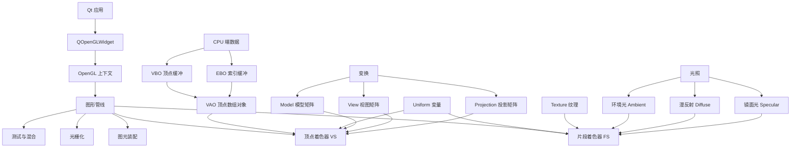

# OpenGL × Qt 学习课程

一套基于 **Qt 5 + QOpenGLWidget + OpenGL 3.3 Core Profile** 的渐进式 OpenGL 学习项目。
每一节课都是独立可运行的可执行程序，配套着色器源码与详细中文注释，循序渐进掌握现代 OpenGL。

> 配套文档（建议按顺序阅读）：
>
> - [Qt + OpenGL 学习手册](docs/Qt_OpenGL_学习手册.md) — 核心知识详解
> - [API 速查表](docs/API速查表.md) — OpenGL / Qt 常用 API 索引
> - [常见问题 FAQ](docs/常见问题FAQ.md) — 避坑指南

---

## 一、项目结构

```
opengl/
├── CMakeLists.txt           # 顶层构建脚本
├── main.cpp                 # 自由练手入口（main_course 可执行文件）
├── lesson/
│   ├── CMakeLists.txt       # 各课程子项目注册
│   ├── lesson01_hello_window/      # 创建 OpenGL 窗口
│   ├── lesson02_hello_triangle/    # VBO + VAO + 着色器
│   ├── lesson03_shader_uniform/    # uniform 变量、Shader 工具类
│   ├── lesson04_ebo_rectangle/     # EBO 索引绘制、线框模式
│   ├── lesson05_texture/           # 纹理贴图、混合
│   ├── lesson06_transform/         # 矩阵变换、动画
│   ├── lesson07_coordinate_3d/     # MVP 矩阵、深度测试
│   ├── lesson08_camera/            # 摄像机、WASD + 鼠标
│   ├── lesson09_basic_lighting/    # Phong 光照模型
│   ├── lesson10_material/          # 材质属性
│   ├── lesson11_lighting_maps/     # 光照贴图（漫反射+镜面贴图）
│   ├── lesson12_light_casters/     # 投光物（方向光/点光源/聚光灯）
│   ├── lesson13_multiple_lights/   # 多光源（方向光+4个点光源）
│   ├── lesson14_framebuffer/       # 帧缓冲 FBO + 后期处理（反相/灰度/锐化/模糊/边缘检测）
│   ├── lesson15_cubemap/           # 立方体贴图 + 天空盒（反射/折射）
│   └── lesson16_instancing/        # 实例化渲染（1000颗小行星带）
│   ├── lesson17_shadow_mapping/     # 阴影映射（PCF软化阴影）
│   ├── lesson18_normal_mapping/     # 法线贴图（程序化砖墙凹凸）
│   └── lesson19_bloom/              # 泛光 Bloom（HDR+高斯模糊+色调映射）
│   ├── lesson20_geometry_shader/     # 几何着色器（炸裂 + 法线可视化）
│   └── lesson21_deferred_shading/    # 延迟渲染（G-Buffer + 多光源）
└── docs/
    ├── Qt_OpenGL_学习手册.md
    ├── API速查表.md
    └── 常见问题FAQ.md
```

每节课目录下通常包含：

| 文件 | 作用 |
|---|---|
| `main.cpp`         | 程序入口，构建 `QApplication` 并显示 OpenGL 控件 |
| `openglwidget.h/.cpp` | 继承 `QOpenGLWidget` 的核心渲染类 |
| `shader.h`         | 着色器加载/编译/链接工具类（lesson03 起） |
| `shaders/*.vert`   | GLSL 顶点着色器 |
| `shaders/*.frag`   | GLSL 片段着色器 |

---

## 二、环境准备

| 组件 | 版本 / 要求 |
|---|---|
| 操作系统 | Windows 10 / 11（已在 Win11 25H2 验证） |
| Qt       | 5.14.2 (msvc2017_64)，安装在 `D:/QT/5.14.2/msvc2017_64` |
| 编译器   | MSVC 2019 / 2022 (x64) |
| CMake    | 3.10+ |
| 显卡驱动 | 支持 OpenGL 3.3 Core Profile（基本 2010 年后所有显卡都满足） |

> 如果 Qt 装在其他路径，编辑顶层 [CMakeLists.txt](CMakeLists.txt) 第 13 行的 `CMAKE_PREFIX_PATH`。

---

## 三、构建与运行

### 1. 命令行构建（推荐）

PowerShell 下执行：

```powershell
# 配置（生成 VS2022 工程）
cmake -S . -B build -G "Visual Studio 17 2022" -A x64

# 构建全部课程（Release 配置）
cmake --build build --config Release

# 运行某节课（示例：第 10 课）
./build/lesson/Release/lesson10_material.exe
```

### 2. 单课构建

```powershell
cmake --build build --config Release --target lesson05_texture
```

### 3. VSCode 调试

项目已在 [lesson/CMakeLists.txt](lesson/CMakeLists.txt) 中通过
`VS_DEBUGGER_WORKING_DIRECTORY` 设置每课的工作目录为其源码目录，
并通过 `target_compile_definitions` 注入 `SHADER_DIR` 宏（绝对路径），
**无论从哪里运行 exe，shader 文件都能正确加载**。

---

## 四、课程索引（推荐学习顺序）

| # | 课程 | 关键 API / 知识点 | 看完你能做什么 |
|---|---|---|---|
| 01 | [Hello Window](lesson/lesson01_hello_window/) | `QOpenGLWidget`、`initializeGL/resizeGL/paintGL`、`glClearColor`、`glClear` | 在 Qt 窗口里创建 OpenGL 上下文并清屏 |
| 02 | [Hello Triangle](lesson/lesson02_hello_triangle/) | VBO / VAO、`glVertexAttribPointer`、最简顶点 + 片段着色器 | 画出第一个三角形 |
| 03 | [Shader & Uniform](lesson/lesson03_shader_uniform/) | `uniform`、`varying`、Shader 工具类（从文件加载） | 让三角形动起来、变颜色 |
| 04 | [EBO Rectangle](lesson/lesson04_ebo_rectangle/) | EBO（索引缓冲）、`glDrawElements`、`glPolygonMode` 线框模式 | 用更少顶点画矩形 / 显示网格线框 |
| 05 | [Texture](lesson/lesson05_texture/) | `glTexImage2D`、纹理坐标、纹理单元、Mipmap、`QImage` 加载 | 给图形贴上图片，混合两张纹理 |
| 06 | [Transform](lesson/lesson06_transform/) | `QMatrix4x4`、`translate/rotate/scale`、矩阵乘法顺序 | 让物体平移、旋转、缩放 |
| 07 | [3D Coordinate](lesson/lesson07_coordinate_3d/) | Model / View / Projection 三大矩阵、`glEnable(GL_DEPTH_TEST)` | 画出真正的 3D 立方体 |
| 08 | [Camera](lesson/lesson08_camera/) | 欧拉角(yaw/pitch)、`lookAt`、deltaTime、键盘 + 鼠标输入 | FPS 风格自由飞行视角 |
| 09 | [Basic Lighting](lesson/lesson09_basic_lighting/) | Phong 光照模型（环境/漫反射/镜面）、法线变换 | 让 3D 物体看起来有立体感 |
| 10 | [Material](lesson/lesson10_material/) | 材质 struct、6 种经典材质（翡翠/黄金/珍珠 等） | 不同材质表现差异 |
| 11 | [Lighting Maps](lesson/lesson11_lighting_maps/) | 漫反射贴图、镜面光贴图、sampler2D | 木箱金属边框效果：木纹无高光、金属有高光 |
| 12 | [Light Casters](lesson/lesson12_light_casters/) | 方向光/点光源/聚光灯，衰减公式，边缘软化 | 按 1/2/3 切换三种灯光，看效果差异 |
| 13 | [Multiple Lights](lesson/lesson13_multiple_lights/) | 多光源混合、uniform 数组、`uPointLights[i]` | 方向光+4个旋转色灯，理解灯光叠加 |
| 14 | [Framebuffer](lesson/lesson14_framebuffer/) | FBO 离屏渲染、颜色附件、后处理特效 | 6种特效：反相/灰度/锐化/模糊/边缘检测 |
| 15 | [Cubemap](lesson/lesson15_cubemap/) | 立方体贴图、天空盒、环境反射/折射 | 6面程序化天空 + 反射折射双球 |
| 16 | [Instancing](lesson/lesson16_instancing/) | `glDrawArraysInstanced`、`glVertexAttribDivisor` | 1000颗小行星带 + 中心行星 |
| 17 | [Shadow Mapping](lesson/lesson17_shadow_mapping/) | 深度贴图FBO、光源空间矩阵、PCF滤波 | 方向光投射阴影，软阴影边缘 |
| 18 | [Normal Mapping](lesson/lesson18_normal_mapping/) | TBN矩阵、切线空间、程序化法线贴图 | 砖墙凹凸细节，不增加顶点 |
| 19 | [Bloom](lesson/lesson19_bloom/) | HDR浮点FBO、高斯模糊、色调映射 | 发光物体泛光效果，按1~5调强度 |
| 20 | [Geometry Shader](lesson/lesson20_geometry_shader/) | `GL_GEOMETRY_SHADER`、`EmitVertex`、炸裂/法线可视化 | GPU上修改图元，1=炸裂 2=法线 3=普通 |
| 21 | [Deferred Shading](lesson/lesson21_deferred_shading/) | G-Buffer MRT、延迟光照、多光源无性能损耗 | 10个彩色移动光源同时照亮场景 |

---

## 五、知识图谱（一图掌握全局）



---

## 六、编码约定

1. 所有源文件 **强制 UTF-8**，CMake 已配置 `/utf-8 /FS`。
2. 类名与文件名采用 `小驼峰/PascalCase` 习惯（`OpenGLWidget`、`Shader`）。
3. 着色器统一用 `#version 330 core`。
4. 资源释放：在析构函数中使用 `makeCurrent()` … `doneCurrent()` 包裹 `glDelete*`。
5. 每帧调用 `update()` 触发 `paintGL`，定时器周期 16ms（约 60 FPS）。

---

## 七、推荐学习资源

| 类型 | 名称 | 说明 |
|---|---|---|
| 教程 | [LearnOpenGL CN](https://learnopengl-cn.github.io/) | 本项目章节顺序与之高度对齐，强烈推荐配合阅读 |
| 文档 | [Qt 5 Documentation](https://doc.qt.io/qt-5/) | `QOpenGLWidget` / `QOpenGLFunctions_3_3_Core` / `QMatrix4x4` |
| 参考 | [OpenGL Reference Pages](https://registry.khronos.org/OpenGL-Refpages/gl4/) | 每个 `gl*` 函数的官方定义 |
| 工具 | [RenderDoc](https://renderdoc.org/) | 抓帧调试，看每个 draw call 的顶点/纹理/uniform |

---

## 八、下一步可扩展

- [x] Lesson 11：光照贴图（Diffuse Map + Specular Map）
- [x] Lesson 12：投光物（Directional / Point / Spot Light）
- [x] Lesson 13：多光源
- [x] Lesson 14：帧缓冲 FBO + 后期处理
- [x] Lesson 15：立方体贴图 + 天空盒
- [x] Lesson 16：实例化渲染
- [x] Lesson 17：阴影映射 (Shadow Mapping)
- [x] Lesson 18：法线贴图 (Normal Mapping)
- [x] Lesson 19：泛光 Bloom
- [x] Lesson 20：几何着色器
- [x] Lesson 21：延迟渲染 (Deferred Shading)
- [ ] Lesson 22：模型加载（Assimp + Mesh 抽象）

---

> 有问题？先翻一下 [docs/常见问题FAQ.md](docs/常见问题FAQ.md)，90% 的"黑屏 / 编译错误 / shader 找不到"都能找到答案。
