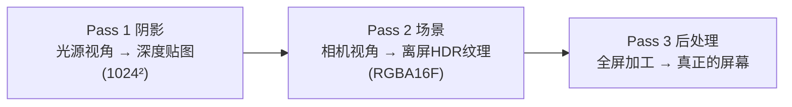
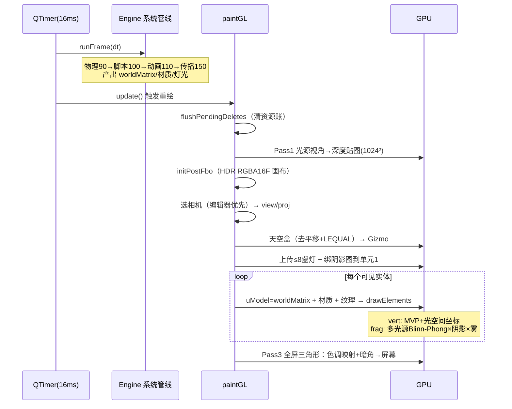

# 07 · 项目渲染流程完整走读

> 实时代码版本。按 paintGL 执行顺序，走读一帧画面从 Qt 定时器触发到像素上屏的完整过程。
> 基础概念（VAO/VBO/Shader/MVP/Blinn-Phong）请先阅读 01-06。

---

## 7.1 渲染相关模块速查

| 文件 | 层次 | 一句话职责 |
|------|------|-----------|
| `Render/MeshFactory.h` | GPU 底层 | 生成 VAO/VBO/EBO、纹理的 GPU 数据 |
| `Render/ResourceManager.h` | 资源层 | 句柄 + 缓存 + 引用计数 + 延迟 GPU 操作 |
| `Render/Shader.h` | GPU 接口 | GLSL 编译链接 + uniform 设置（带位置缓存） |
| `Shaders/default.vert/frag` | GPU 程序 | 顶点变换 + 多光源 Blinn-Phong + 阴影 + 雾 |
| `Render/RenderWidget.cpp` | 主循环 | 每帧编排：阴影 → 场景 → 后处理 |

---

## 7.2 渲染之前：数据从哪来

paintGL 消费的是**本帧逻辑阶段准备好的数据**。回顾 phase 管线：

```
QTimer(16ms) 触发一帧
  ↓ Engine::runFrame(dt)
  物理(90)   → 写 TransformComponent.position（局部）
  脚本(100)  → anim_play / set_position...
  动画(110)  → 采样关键帧写 Transform/Material 字段
  传播(150)  → 算出每个实体的 worldMatrix（含父子链）
  ↓
renderWidget->update() → Qt 调度 paintGL()
```

**关键认知**：渲染系统只是"读数据的照相机"。它读三样：

| 数据 | 谁准备的 | 渲染怎么用 |
|------|---------|-----------|
| `tf.worldMatrix` | TransformSystem(150) | 直接当 uModel（不再自己算矩阵） |
| `Material / Light / Camera` | 编辑器/动画/脚本 | 喂给 shader uniform |
| `meshHandle / spriteHandle` | ResourceManager | 换取 VAO / 纹理 id |

---

## 7.3 多 Pass 架构（为什么不能一遍画完）

现代渲染的核心思想是**分轮渲染到不同目标**：



必须多 Pass 的原因：阴影需要先知道"光看到了什么"（Pass 1 产出深度图）；色调映射需要"整个场景画完的结果"（Pass 2 产出场景纹理）。这是 [lesson14](./14-framebuffer.md)（FBO）和 [lesson17](./17-shadow-mapping.md)（阴影）在真实引擎中的组合。

---

## 7.4 paintGL 逐段走读

### 帧首：延迟删除 + 防御检查

```cpp
void RenderWidget::paintGL() {
    ResourceManager::instance().flushPendingDeletes();
    // 上一帧释放的 GPU 资源在这里真正 glDelete。
    // paintGL 是全程序唯一保证"GL 上下文有效"的地方
```

为什么放帧首？任何地方（编辑器删实体、加载场景）释放资源都只是"挂账"，这里统一清账——**延迟 GPU 操作架构**，每帧第一件事。

---

## 7.5 Pass 1：阴影 — 站在光的位置看一遍世界

```cpp
glm::mat4 lightSpace = renderShadowPass();
```

#### 7.5.1 找光源、构造光空间矩阵

```cpp
m_world->each([&](flecs::entity, const LightComponent &lc) {
    if (lc.type == 0) { dir = normalize(lc.direction); }
});
if (!hasDir) return glm::mat4(1);   // 没方向光 → 单位阵 = 阴影关闭信号

glm::vec3 lightPos = center - dir * 30.0f;
glm::mat4 lightView = glm::lookAt(lightPos, center, up);
glm::mat4 lightProj = glm::ortho(-25, 25, -25, 25, 1, 80); // 正交投影
```

**知识点：为什么方向光用正交投影**？太阳光线平行，无"近大远小"——正交投影正好表达平行光线。点光源才需要透视/立方体贴图（项目未做）。

#### 7.5.2 渲染深度贴图

```cpp
glViewport(0, 0, kShadowSize, kShadowSize);       // 切到 1024²
glBindFramebuffer(GL_FRAMEBUFFER, m_shadowFbo);   // 只有深度附件的 FBO
glClear(GL_DEPTH_BUFFER_BIT);
m_depthShader.use();                              // 深度专用 shader
m_world->each([...] { 设 uModel → draw; });       // 只写深度，不写颜色
```

产出：一张贴图，每像素记录"光沿这个方向看过去，最近的物体离我多远"。

#### 7.5.3 阴影 FBO 初始化时的细节

```cpp
// initShadow() 中的关键设置：
glTexParameteri(GL_TEXTURE_2D, GL_TEXTURE_WRAP_S, GL_CLAMP_TO_BORDER);
glTexParameteri(GL_TEXTURE_2D, GL_TEXTURE_WRAP_T, GL_CLAMP_TO_BORDER);
float border[] = {1.0f, 1.0f, 1.0f, 1.0f};
glTexParameterfv(GL_TEXTURE_2D, GL_TEXTURE_BORDER_COLOR, border);
```

边缘设白色（深度 = 1.0 = 最远）：超出光锥范围的点采样到"最远"，判定为不在阴影里，防止场景边缘出现大片错误黑影。这是 lesson17 shadow mapping 的标准防御。

---

## 7.6 Pass 2：主场景 — 画到离屏画布

### 7.6.1 准备 HDR 离屏 FBO

```cpp
initPostFbo(width(), height());
glBindFramebuffer(GL_FRAMEBUFFER, postOn ? m_sceneFbo : defaultFramebufferObject());
```

颜色附件是 **GL_RGBA16F**（每通道 16 位浮点）。普通 RGBA8 只能存 0~1 的颜色，HDR 浮点纹理能存"亮度 3.7"这种超亮值，留给 Pass 3 色调映射压缩。这是 [lesson19](./19-bloom.md)（bloom）的前置知识。

窗口 resize 时 FBO 必须重建（分辨率匹配），代码用"尺寸没变就复用"的缓存策略。

### 7.6.2 选相机（一段很讲究的逻辑）

```cpp
bool foundEditor = false;
m_world->each([&](flecs::entity, const CameraComponent &cam) {
    if (!cam.active) return;
    if (foundEditor && !cam.isEditor) return;  // 编辑器相机优先
    if (cam.isEditor) foundEditor = true;
    view = cam.viewMatrix;
    proj = glm::perspective(radians(cam.fov), 宽高比, near, far);  // 这里才算投影
});
```

两个设计点：

1. **编辑器相机优先**：编辑场景可能摆了游戏相机，但编辑时用自由视角。同一段代码在 my_game（无编辑器相机）自然落到游戏相机——一份逻辑两种环境都对
2. **投影矩阵在渲染端现算**：只有 RenderWidget 知道窗口真实宽高比（`width()/height()`），`CameraComponent` 本身不存宽高比

顺手存 `m_lastView/m_lastProj`——鼠标点选实体时做屏幕→射线逆变换用（数据复用）。

### 7.6.3 天空盒（最先画，当背景）

```cpp
glDepthFunc(GL_LEQUAL);                          // 放宽深度测试
glm::mat4 skyView = glm::mat4(glm::mat3(view));  // 去掉相机平移
```

两个经典技巧：

- **去掉平移**：取 view 左上 3×3（只留旋转）升回 4×4——天空只随相机转头，不随移动，制造"无限远"错觉（lesson15 cubemap）
- **LEQUAL**：天空盒深度恒为 1.0，默认的 GL_LESS 判"1.0 < 1.0 = false"永远画不出，放宽成 ≤ 才能通过。画完立即恢复 GL_LESS

然后 `drawGizmo` 画编辑器网格地面 + RGB 三色轴（line 绘制，运行模式 `m_showGizmo=false` 跳过）。

### 7.6.4 上传全局光照数据（数据驱动多光源）

```cpp
int lightIdx = 0;
m_world->each([&](flecs::entity, const LightComponent &lc, const TransformComponent &tf) {
    if (lightIdx >= 8) return;                    // shader MAX_LIGHTS=8
    std::string p = "uLights[" + std::to_string(lightIdx) + "].";
    m_shader.setInt(p+"type", lc.type);           // 0方向 1点 2聚光
    m_shader.setVec3(p+"position", tf.position);  // 点/聚光用实体位置
    m_shader.setVec3(p+"diffuse", lc.diffuse * lc.intensity);
    // CPU 预算余弦：省得 GPU 每个像素算 acos —— 重要的性能直觉
    m_shader.setFloat(p+"spotCos", cos(radians(lc.spotAngle)));
    ++lightIdx;
});
m_shader.setInt("uLightCount", lightIdx);
```

**"能在 CPU 每帧算一次的，绝不在 GPU 每像素算一次"**——聚光灯锥角余弦在 CPU 预算，shader 里只做 `dot > cos` 比较。

### 7.6.5 绑定阴影资源

```cpp
m_shader.setMat4("uLightSpaceMatrix", lightSpace);
glActiveTexture(GL_TEXTURE1);          // 单元 1 给阴影深度图
glBindTexture(GL_TEXTURE_2D, m_shadowTex);
glActiveTexture(GL_TEXTURE0);          // ★ 复位！单元 0 留给精灵纹理
```

**纹理单元必须复位**：`glActiveTexture` 切换"当前操作哪个插槽"，不复位会导致后面绑精灵纹理会绑错槽——多纹理管理是新手高频错误区。

### 7.6.6 实体循环（真正的绘制）

```cpp
m_world->each([this](flecs::entity e, TransformComponent &tf, const MeshComponent &ms) {
    if (!ms.isValid() || !tf.visibleInTree) return;

    m_shader.setMat4("uModel", tf.worldMatrix);       // ① 传播好的世界矩阵
    m_shader.setMat3("uNormalMatrix", tf.worldNormalMatrix);

    // ② 材质（可选组件，无则默认灰）
    if (mat) { 设 uMaterial 四件套; } else { 设默认值; }

    // ③ 精灵纹理（可选）：惰性 acquire + 绑当前帧到单元 0
    if (sp && sp->folder[0]) { ... m_shader.setInt("uHasTexture", 1); }

    // ④ 句柄 → GPU 网格 → draw call
    const GpuMesh *gm = ResourceManager::instance().get(ms.meshHandle);
    glBindVertexArray(gm->vao);
    glDrawElements(gm->primitiveType, gm->indexCount, GL_UNSIGNED_INT, nullptr);
});
```

每个实体一次 draw call，`glDrawElements` 一声令下，GPU 流水线启动——进入 shader。

---

## 7.7 GPU 内部：两个 shader 各干什么

### default.vert（每个顶点跑一次）

```glsl
vec4 worldPos = uModel * vec4(aPos, 1.0);            // 局部 → 世界
vFragPos = vec3(worldPos);                            // 传给片元（光照用）
vNormal = normalize(uNormalMatrix * aNormal);         // 法线专用矩阵
vFragPosLightSpace = uLightSpaceMatrix * worldPos;    // ★ 光空间坐标（阴影用）
gl_Position = uProjection * uView * worldPos;         // MVP → 裁剪空间
```

**知识点：为什么法线用 normalMatrix？** 物体非等比缩放时，法线不能用 model 矩阵直接变换（会歪），必须用 model 的逆转置矩阵——`worldNormalMatrix` 由 TransformSystem 预算好。

### default.frag（每个像素跑一次）

```glsl
for (i < uLightCount) result += calcLight(uLights[i], norm, viewDir);
```

`calcLight` 对每盏灯做四件事（06/12/13/17 的集大成）：

**① 按光型算方向和衰减**：方向光不衰减；点光 `(1-dist/range)²` 平滑归零；聚光再乘锥角过渡系数

**② Blinn-Phong 三项**：`ambient + 漫反射(dot(N,L)) + 高光(半程向量)` —— 光色 × 材质反射色

**③ 阴影判定**（只对方向光）：

```glsl
vec3 proj = fragPosLightSpace.xyz / fragPosLightSpace.w;
proj = proj * 0.5 + 0.5;                 // NDC[-1,1] → [0,1] 纹理坐标
float closestDepth = texture(shadowMap, proj.xy).r;
float bias = max(0.002 * (1-dot(N,L)), 0.0005); // 防"阴影痤疮"
float shadow = (currentDepth - bias > closestDepth) ? 0.0 : 1.0; // 被挡=阴影
```

- **bias 偏移**：防止物体表面自己被自己判定为阴影（"阴影痤疮"条纹）。斜面偏移更大（法线与光夹角大时），是经验公式
- **PCF 软化**：实际代码是 3×3 邻域取 9 个采样平均，把硬锯齿变柔和过渡

**④ 组合**：`ambient + (diffuse+specular) * shadow * attenuation` —— 阴影不削弱环境光（阴影区不全黑，更真实）

最后叠纹理（`result *= tex.rgb`，alpha<0.1 discard 镂空）、距离雾（`mix(result, fogColor, 1-e^(-density*dist))`），输出到 HDR 离屏纹理——此刻还没到屏幕。

---

## 7.8 Pass 3：后处理 — 全屏加工上屏

```cpp
glBindFramebuffer(GL_FRAMEBUFFER, defaultFramebufferObject());  // 切回"屏幕"
glDisable(GL_DEPTH_TEST);                                       // 全屏贴图不需要深度
glBindTexture(GL_TEXTURE_2D, m_sceneTex);                       // 场景纹理当输入
m_postShader.setFloat("uExposure", 1.0f);                       // 色调映射曝光
m_postShader.setFloat("uVignette", 0.25f);                      // 暗角
glBindVertexArray(m_postVao);                                   // 空 VAO！
glDrawArrays(GL_TRIANGLES, 0, 3);                              // 画 3 个顶点？
```

三个精彩细节：

1. **`defaultFramebufferObject()` 而不是 0**：QOpenGLWidget 的"屏幕"其实是 Qt 管理的 FBO，绑 0 会画到错误目标——Qt 环境特有陷阱
2. **全屏大三角形**：不画两个三角形拼矩形，而是画一个超出屏幕的大三角形（顶点由 `gl_VertexID` 在 post.vert 里从硬编码数组取值，VAO 空的、无 VBO），被裁剪后恰好覆盖全屏——比四边形少一条对角线接缝，行业标准技巧
3. **色调映射**：把 HDR 的 [0, ∞) 亮度压缩回显示器 [0,1]，这就是 Pass 2 用 RGBA16F 的原因——先允许"过亮"，最后统一压

至此像素上屏，一帧结束。

**帧末**：

```cpp
// Qt 的 QOpenGLWidget::update() 自动 swapBuffer → 双缓冲翻转
```

---

## 7.9 完整一帧时序图



---

## 7.10 知识点复习清单

| # | 知识点 | 出处 | 对应 lesson |
|---|--------|------|------------|
| 1 | 多 Pass 架构（阴影→场景→后处理） | paintGL 整体 | 14/17/19 |
| 2 | 方向光阴影用正交投影 | renderShadowPass | 17 |
| 3 | 深度贴图 border=白 防边缘误判 | initShadow | 17 |
| 4 | shadow bias + PCF 软阴影 | default.frag calcShadow | 17 |
| 5 | 天空盒去平移 + LEQUAL | drawSky | 15 |
| 6 | HDR 离屏(RGBA16F) + 色调映射 | initPostFbo/drawPostProcess | 14/19 |
| 7 | 全屏大三角形 + gl_VertexID 空 VAO | drawPostProcess | 进阶 |
| 8 | 纹理单元分配与复位 | 阴影绑单元1 | 05/11 |
| 9 | CPU 预算 cos 省 GPU per-pixel acos | spotCos | 性能直觉 |
| 10 | 数据驱动多光源（挂灯即生效） | 灯光收集循环 | 13 |
| 11 | worldMatrix 由 TransformSystem 供给，渲染只消费 | 实体循环 | 项目架构 |
| 12 | Qt "屏幕"是 defaultFramebufferObject() | drawPostProcess | Qt 特有坑 |

---

## 7.11 自我检验（三个思考题）

1. **顺序题**：把 `drawSky` 挪到实体循环之后画，画面出什么问题？（提示：LEQUAL + 已有深度值）
2. **改造题**：想让聚光灯也投影阴影，Pass 1 需要改哪两处？（提示：投影类型、每灯一张深度图）
3. **调试题**：某物体在场景里能看见但影子没了，依次检查哪几个环节？（光类型→光锥范围→shadowOn→bias→FBO 完整）

---

**返回**: [07-实战-项目渲染流程走读](./07-实战-项目渲染流程走读.md)
