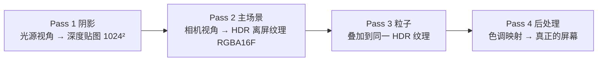

# 游戏引擎渲染系统实战

> 本文聚焦 `my_demo` 引擎**渲染系统的工程实现**：多 Pass 架构、PBR 材质、阴影、粒子、后处理，以及支撑它们的资源管理与着色器封装。
>
> 与 `docs/opengl/` 的区别：那里教 OpenGL 基础知识（VAO/VBO/Shader/MVP/光照原理）；**本文假设你已掌握这些**，讲的是"如何把这些拼装成一个引擎的渲染管线、为什么这样设计"。
>
> 对应代码：`Render/RenderWidget.cpp`（主循环）、`Render/Shader.h`、`Render/MeshFactory.h`、`Render/ResourceManager.h`、`assets/Shaders/*.vert/frag`、`Components/{Material,Light,Environment,Particle}Component.h`、`Systems/ParticleSystem.h`。

---

## 目录

| 章节 | 内容 |
| ------ | ------ |
| 一 | [渲染系统在引擎中的位置](#一渲染系统在引擎中的位置) |
| 二 | [多 Pass 架构总览](#二多-pass-架构总览) |
| 三 | [帧生命周期：paintGL 全流程](#三帧生命周期paintgl-全流程) |
| 四 | [Pass 1：阴影](#四pass-1阴影) |
| 五 | [Pass 2：主场景](#五pass-2主场景) |
| 六 | [Pass 3：粒子](#六pass-3粒子) |
| 七 | [Pass 4：后处理](#七pass-4后处理) |
| 八 | [着色器详解](#八着色器详解) |
| 九 | [支撑设施](#九支撑设施) |
| 十 | [数据驱动的渲染组件](#十数据驱动的渲染组件) |
| 十一 | [关键工程决策与坑](#十一关键工程决策与坑) |
| 十二 | [扩展指南](#十二扩展指南) |

---

## 一、渲染系统在引擎中的位置

引擎的黄金法则：**渲染系统只是"读数据的照相机"，自己不产生状态**。

一帧分两半——前半段逻辑系统按 phase 顺序改数据，后半段渲染读数据画画面：

```
QTimer(16ms) → Engine::runFrame(dt)
  物理(90) → 脚本(100) → 动画/粒子(110) → Transform 传播(150)
       ↓ 产出
  worldMatrix / Material / Light / Environment / 粒子池
       ↓
renderWidget->update() → paintGL() 读上述数据渲染
```

渲染端读三类数据，全部来自 ECS World：

| 数据 | 生产者 | 渲染端用途 |
| ------ | -------- | ----------- |
| `tf.worldMatrix` / `worldNormalMatrix` | TransformSystem(150) | uModel / uNormalMatrix（含父子层级，渲染不再自己算矩阵） |
| `MaterialComponent` / `LightComponent` / `EnvironmentComponent` | 编辑器 / 动画 / 脚本 | shader uniform |
| `meshHandle` / `spriteHandle` / 粒子池 | ResourceManager / ParticleSystem | VAO / 纹理 / instance buffer |

**这个分离带来的好处**：渲染逻辑无副作用、可单独替换；动画/物理/脚本改的是同一份 Transform，渲染永远读到"本帧最终结果"（因为 Transform 传播排在 phase 150 最后）。

---

## 二、多 Pass 架构总览

现代渲染不是"一遍画完"，而是分几轮画到不同目标：



**为什么必须分 Pass**（每个 Pass 都依赖前一个的产出）：

- 算阴影需要先知道"光看到了什么" → Pass 1 先产出深度图，Pass 2 才能查询
- 做 HDR 色调映射需要"整个场景画完的亮度" → Pass 2/3 先画到浮点纹理，Pass 4 再统一压缩
- 粒子是半透明的，必须在不透明物体之后画 → 独立 Pass 3

---

## 三、帧生命周期：paintGL 全流程

`RenderWidget::paintGL()` 是总指挥，完整顺序：

```cpp
void RenderWidget::paintGL() {
    ResourceManager::instance().flushPendingDeletes();   // ① 清资源账
    glm::mat4 lightSpace = renderShadowPass();           // ② Pass1 阴影
    initPostFbo(width(), height());                      // ③ 准备 HDR 画布
    glBindFramebuffer(GL_FRAMEBUFFER, postOn ? m_sceneFbo : defaultFramebufferObject());
    // ④ 选相机 → view/proj
    // ⑤ drawSky → drawGizmo
    // ⑥ 上传光源 + 绑阴影贴图
    // ⑦ 遍历实体绘制（Pass2 主场景）
    drawParticles(view, proj);                           // ⑧ Pass3 粒子
    if (postOn) drawPostProcess();                       // ⑨ Pass4 后处理上屏
}
```

**第 ① 步为什么在帧首**：paintGL 是全程序**唯一保证 GL 上下文有效**的地方。任何地方（编辑器删实体、加载场景、脚本创建）释放 GPU 资源都只是"挂账"，这里统一清账。这是"延迟 GPU 操作"架构的落点（见第九章）。

---

## 四、Pass 1：阴影

技术是 Shadow Mapping，核心一句话：**影子 = 光看不见的地方**。让光当一次相机，把它看到的深度存下来。

### 4.1 构造光空间矩阵

```cpp
// 只取第一个方向光投影
glm::vec3 lightPos = center - dir * 30.0f;
glm::mat4 lightView = glm::lookAt(lightPos, center, up);
glm::mat4 lightProj = glm::ortho(-25, 25, -25, 25, 1, 80);   // ★ 正交投影
glm::mat4 lightSpace = lightProj * lightView;
```

**为什么方向光用正交投影**：太阳光线平行，没有"近大远小"——正交投影正好表达平行光。点光源才需要透视/立方体贴图（本引擎未做，是简化）。

### 4.2 渲染深度贴图

```cpp
glViewport(0, 0, kShadowSize, kShadowSize);       // 切到 1024²
glBindFramebuffer(GL_FRAMEBUFFER, m_shadowFbo);   // 只挂深度附件的 FBO
glClear(GL_DEPTH_BUFFER_BIT);
m_depthShader.use();                              // 深度专用：不算光照、不写颜色
m_world->each([...](Transform, Mesh){ 设 uModel → draw; });  // 极快
```

产出：一张贴图，每 texel 记录"光沿此方向看去，最近物体的深度"。

### 4.3 一个必知的防御细节

阴影贴图初始化时把**边缘 border 设为白色（深度=1.0=最远）**：

```cpp
glTexParameteri(GL_TEXTURE_2D, GL_TEXTURE_WRAP_S, GL_CLAMP_TO_BORDER);
float border[] = {1,1,1,1};
glTexParameterfv(GL_TEXTURE_2D, GL_TEXTURE_BORDER_COLOR, border);
```

否则超出光锥范围的点采样到边缘会被误判为阴影，场景边缘出现大片错误黑影。

### 4.4 关闭信号

无方向光时 `renderShadowPass` 返回单位矩阵，主场景据此把 `uShadowEnabled` 设 0——**用返回值兼当"要不要阴影"的开关**，避免额外状态位。

---

## 五、Pass 2：主场景

### 5.1 HDR 离屏画布

```cpp
// initPostFbo：颜色附件用 GL_RGBA16F（每通道 16 位浮点）
glTexImage2D(GL_TEXTURE_2D, 0, GL_RGBA16F, w, h, 0, GL_RGBA, GL_FLOAT, nullptr);
```

普通 RGBA8 只能存 [0,1] 颜色，**HDR 浮点纹理能存"亮度 3.7"这种超亮值**——粒子 `intensity>1`、强光反射先允许过亮，留给 Pass 4 统一压缩。窗口 resize 时按"尺寸变了才重建"策略重建 FBO。

### 5.2 相机选择（很讲究）

```cpp
bool foundEditor = false;
m_world->each([&](flecs::entity, const CameraComponent &cam){
    if (!cam.active) return;
    if (foundEditor && !cam.isEditor) return;   // 编辑器相机优先，游戏相机不覆盖
    if (cam.isEditor) foundEditor = true;
    view = cam.viewMatrix;
    proj = glm::perspective(radians(cam.fov), 宽高比, near, far);  // 投影在渲染端算
});
```

两个设计点：

1. **编辑器相机优先**：编辑场景里可能摆了游戏相机，但编辑时用自由视角；同一段代码在 `my_game`（无编辑器相机）自然落到游戏相机——一份逻辑两种环境都对。
2. **投影矩阵在渲染端现算**：只有 RenderWidget 知道窗口真实宽高比。CameraComponent 里不存宽高比。

顺手存 `m_lastView/m_lastProj`——鼠标点选做屏幕→射线逆变换复用。

### 5.3 天空盒

```cpp
glDepthFunc(GL_LEQUAL);                           // 放宽深度测试
glm::mat4 skyView = glm::mat4(glm::mat3(view));   // 抹掉平移（只留旋转）
// 天空色由 EnvironmentComponent 提供（horizonColor/zenithColor/groundColor）
```

- **抹平移**：天空只随相机转头、不随移动——制造"无限远"错觉
- **LEQUAL**：天空深度恒为 1.0，默认 `GL_LESS` 判 `1.0<1.0=false` 永远画不出，放宽成 ≤ 才能通过；画完立即恢复 `GL_LESS`

### 5.4 多光源上传（数据驱动）

```cpp
int lightIdx = 0;
m_world->each([&](flecs::entity, const LightComponent &lc, const TransformComponent &tf){
    if (lightIdx >= 8) return;                    // shader MAX_LIGHTS=8
    std::string p = "uLights[" + std::to_string(lightIdx) + "].";
    m_shader.setInt(p+"type", lc.type);           // 0方向 1点 2聚光
    m_shader.setVec3(p+"position", tf.position);  // 点/聚光用实体世界位置
    m_shader.setVec3(p+"diffuse", lc.diffuse * lc.intensity);
    m_shader.setFloat(p+"spotCos", cos(radians(lc.spotAngle)));  // ★ CPU 预算余弦
    ++lightIdx;
});
m_shader.setInt("uLightCount", lightIdx);
```

两个要点：

- **数据驱动**：场景里挂几盏灯就传几盏，加灯不改渲染代码
- **CPU 预算 cos**：聚光锥角判定在 shader 里是 `dot > cos(角)`。CPU 每帧算一次 cos，省得 GPU 每个像素算一次 `acos`——"能在 CPU 每帧算一次的，绝不在 GPU 每像素算一次"是核心性能直觉

### 5.5 绑定阴影贴图（纹理单元管理）

```cpp
glActiveTexture(GL_TEXTURE1);                 // 单元 1 给阴影深度图
glBindTexture(GL_TEXTURE_2D, m_shadowTex);
glActiveTexture(GL_TEXTURE0);                 // ★ 复位！单元 0 留给精灵纹理
```

GPU 可同时绑多张纹理，靠单元编号区分：单元 0 物体贴图、单元 1 阴影图。**用完必须复位**，否则后面绑精灵纹理会绑错槽——多纹理管理的高频错误。

### 5.6 实体绘制循环

```cpp
m_world->each([this](flecs::entity e, TransformComponent &tf, const MeshComponent &ms){
    if (!ms.isValid() || !tf.visibleInTree) return;      // 隐藏（含父隐藏）跳过
    m_shader.setMat4("uModel", tf.worldMatrix);          // 传播好的世界矩阵
    m_shader.setMat3("uNormalMatrix", tf.worldNormalMatrix);
    // 材质（PBR 四参，可选组件，无则默认）
    m_shader.setVec3("uMaterial.albedo", mat->albedo);
    m_shader.setFloat("uMaterial.metallic", mat->metallic);
    m_shader.setFloat("uMaterial.roughness", mat->roughness);
    m_shader.setFloat("uMaterial.ao", mat->ao);
    // 精灵纹理（可选）→ 绑单元 0
    // 句柄 → GpuMesh → draw call
    const GpuMesh *gm = ResourceManager::instance().get(ms.meshHandle);
    glBindVertexArray(gm->vao);
    glDrawElements(gm->primitiveType, gm->indexCount, GL_UNSIGNED_INT, nullptr);
});
```

每个可见实体一次 draw call。

---

## 六、Pass 3：粒子

对标 Godot CPUParticles3D，**CPU 模拟 + GPU 实例化**（OpenGL 3.3 无 compute shader）。分工：`ParticleSystem`（纯逻辑，可无 GL 单测）+ `RenderWidget::drawParticles`（呈现）。

### 6.1 CPU 模拟（ParticleSystem，phase=110）

```cpp
// ① 发射：emitAccum += rate*dt，攒够 1.0 生成一个粒子（初速度在 direction 锥内随机）
// ② 积分：vel += gravity*dt; pos += vel*dt; age += dt
// ③ 回收：age >= life 的与末尾交换后 pop（swap-and-pop，O(1) 删除）
```

粒子在**世界空间**模拟（发射后不跟随发射器，火把挥舞会留拖尾，Godot local_coords=false 同款）。

### 6.2 GPU 实例化渲染（billboard）

```cpp
glEnable(GL_BLEND);
glDepthMask(GL_FALSE);                 // 深度只测不写：粒子间不互相剔除（半透明标准做法）
// 每个粒子打包 instance 数据：pos(3) size(1) color(4)，颜色/大小按寿命 t 插值
if (pc.additive) glBlendFunc(GL_SRC_ALPHA, GL_ONE);            // 火/光效：加法叠亮
else             glBlendFunc(GL_SRC_ALPHA, GL_ONE_MINUS_SRC_ALPHA); // 烟/尘：普通 alpha
glBufferData(..., GL_STREAM_DRAW);     // 每帧全量重写 instance buffer
glDrawArraysInstanced(GL_TRIANGLE_STRIP, 0, 4, pool.size());   // 一次画全部粒子
glDepthMask(GL_TRUE);
```

**billboard（始终面向相机）** 在 `particle.vert` 里用相机的右/上轴（view 矩阵前两列）把一个 quad 展开到粒子位置。

**为什么排在不透明之后、后处理之前**：半透明必须最后画；且画在 HDR 离屏纹理里，`intensity>1` 的粒子经色调映射会有辉光感。

---

## 七、Pass 4：后处理

```cpp
glBindFramebuffer(GL_FRAMEBUFFER, defaultFramebufferObject());  // 切回"屏幕"
glDisable(GL_DEPTH_TEST);                                       // 全屏贴图不需深度
glBindTexture(GL_TEXTURE_2D, m_sceneTex);                       // 场景 HDR 纹理当输入
m_postShader.setFloat("uExposure", env.exposure);              // 曝光（EnvironmentComponent）
m_postShader.setFloat("uVignette", env.vignette);              // 暗角
glBindVertexArray(m_postVao);                                   // 空 VAO！
glDrawArrays(GL_TRIANGLES, 0, 3);                              // 3 个顶点？
```

三个精彩细节：

1. **`defaultFramebufferObject()` 而不是 0**：QOpenGLWidget 的"屏幕"其实是 Qt 管理的一个 FBO，绑 0 会画到错误目标——Qt 环境特有陷阱。
2. **全屏大三角形**：不画两个三角形拼矩形，而是画一个**超出屏幕的大三角形**（顶点由 `gl_VertexID` 在 shader 里生成，所以 VAO 是空的、无 VBO），裁剪后恰好覆盖全屏——比四边形少一条对角线接缝，是行业标准技巧。
3. **色调映射（tone mapping）**：把 HDR 的 [0,∞) 亮度压回显示器 [0,1]。这就是 Pass 2 用 RGBA16F 的原因——先允许过亮，最后统一压。

---

## 八、着色器详解

### 8.1 default.vert（每顶点一次）

```glsl
vec4 worldPos = uModel * vec4(aPos, 1.0);            // 局部 → 世界
vFragPos = vec3(worldPos);                            // 传片元（光照用）
vNormal = normalize(uNormalMatrix * aNormal);         // 法线专用矩阵
vFragPosLightSpace = uLightSpaceMatrix * worldPos;    // ★ 光空间坐标（阴影用，顶点端预算）
gl_Position = uProjection * uView * worldPos;         // MVP → 裁剪空间
```

**法线为什么用 normalMatrix**：物体非等比缩放时，法线不能用 model 矩阵直接变换（会歪），必须用 model 的逆转置矩阵——`worldNormalMatrix` 由 TransformSystem 预算好。

### 8.2 default.frag（每像素一次）—— PBR

材质模型是 **PBR 金属度/粗糙度工作流**（对标 Godot StandardMaterial3D），BRDF 为 Cook-Torrance：

```glsl
struct Material {
    vec3 albedo;    // 基础色（非金属=漫反射色，金属=反射色调）
    float metallic; // 0=塑料/木/石  1=金属
    float roughness;// 0=镜面锐利  1=完全粗糙
    float ao;       // 环境光遮蔽
};
```

**为什么用 PBR 取代 Blinn-Phong**：旧模型 ambient/diffuse/specular/shininess 四参互相独立、无物理约束，调不出真实质感；PBR 两个直觉滑杆（金属度/粗糙度）覆盖绝大多数材质，且能量守恒（高光和漫反射自动此消彼长）。

逐光源累加：`for(i<uLightCount) result += calcLight(...)`，每盏灯算 Cook-Torrance + 距离/锥角衰减 + 阴影因子。

**阴影判定（PCF 软化）**：

```glsl
vec3 proj = fragPosLightSpace.xyz / fragPosLightSpace.w;
proj = proj * 0.5 + 0.5;                              // NDC → [0,1] 纹理坐标
float bias = max(0.002*(1-dot(N,L)), 0.0005);         // 防"阴影痤疮"条纹
// 3×3 邻域采样 9 次取平均 → 硬锯齿变柔和
```

- **bias**：防止物体表面自己被判成阴影（斜面偏移更大）
- **PCF**：3×3 采样平均，软化阴影边缘
- 阴影只削弱漫反射+高光，**保留环境光**（阴影区不全黑，更真实）

最后叠纹理（`alpha<0.1 discard` 镂空）、距离雾（`mix(result, fogColor, 1-e^(-density·dist))`），输出到 HDR 离屏纹理。

---

## 九、支撑设施

### 9.1 ResourceManager：句柄 + 引用计数 + 延迟 GPU

**句柄取代裸指针**（对标 Unreal/Unity）：

```
实体A ─┐
实体B ─┼─ meshHandle=1 ──▶ ["cube" refCount=3, VAO=5]
实体C ─┘                    ↑ 100 个立方体只占 1 份显存
```

**延迟 GPU 操作**（本引擎最重要的渲染架构决策）：

```
acquireMesh()  = 纯登记（不碰 GL！任何时机/调用方都安全）
get(handle)    = 首次访问时才创建 GPU 数据（在 paintGL 里，天然有上下文）
releaseMesh()  = 引用归零只挂"待删列表"
flushPendingDeletes() = 每帧渲染前统一 glDelete
```

**解决的问题**：OpenGL 操作必须在有上下文时调用，但序列化/编辑器命令/脚本创建实体都没有 GL 上下文。延迟化后上层代码彻底不碰 GL——配合 Engine 里 `MeshComponent` 的 `OnRemove` observer 自动释放，任何调用方都不需要"记得释放"。

### 9.2 Shader：uniform 位置缓存

```cpp
GLint loc(const std::string &name) {
    auto it = m_locCache.find(name);
    if (it != m_locCache.end()) return it->second;   // 命中缓存
    GLint l = glGetUniformLocation(m_program, name.c_str());
    m_locCache[name] = l;                             // 即使 -1 也缓存
    return l;
}
```

`glGetUniformLocation` 是向驱动查询的慢操作，每帧每物体十几次、几百个物体就是卡顿主因。哈希表缓存"名字→位置"，首帧填充后全是内存查找。

### 9.3 MeshFactory：几何数据生成

一个顶点 = 位置(3) + 法线(3) + UV(2) = 8 float。**立方体是 24 顶点而非 8**：每个面法线不同，同一个角在三个面上要拆成三个顶点，否则光照错误。

---

## 十、数据驱动的渲染组件

渲染相关组件都是 POD + REFLECT 标记，由 `reflect_gen` 自动生成反射——编辑器面板 / 序列化 / 动画轨道自动支持：

| 组件 | 关键字段 | 驱动什么 |
| ------ | --------- | --------- |
| `MaterialComponent` | albedo/metallic/roughness/ao | PBR 材质 |
| `LightComponent` | type/direction/diffuse/intensity/range/spotAngle | 多光源（≤8） |
| `EnvironmentComponent` | horizon/zenith/groundColor、exposure、vignette、fogColor/Density | 天空/后处理/雾（对标 WorldEnvironment，场景级单例，RenderWidget 取第一个） |
| `ParticleComponent` | rate/lifetime/direction/spread/gravity/color/size/additive | 粒子发射器 |

**EnvironmentComponent 的意义**：天空色/曝光/暗角/雾原本硬编码在 RenderWidget.cpp，想做黄昏/雾天得改 C++ 重编译。做成组件后变成"场景数据"——编辑器实时调、每个场景各自氛围、随场景序列化。无此组件时 RenderWidget 回退默认值（老场景观感不变）。

---

## 十一、关键工程决策与坑

| 决策/坑 | 说明 |
| --------- | ------ |
| worldMatrix 由 TransformSystem 供给 | 渲染只消费，不自己算矩阵；父子层级、动画、物理的结果都已合并其中 |
| 投影矩阵在渲染端算 | 只有 RenderWidget 知道窗口宽高比；CameraComponent 的 projMatrix 不可靠 |
| CPU 预算 cos | 聚光锥角余弦在 CPU 算一次，不在 GPU 每像素算 |
| 纹理单元用完复位 | `glActiveTexture(GL_TEXTURE0)` 复位，否则后续绑图错槽 |
| Qt 的"屏幕"是 defaultFramebufferObject() | 后处理上屏不能绑 FBO 0 |
| 延迟 GPU 删除 | 释放只挂账，paintGL 帧首统一执行——上层无需 makeCurrent |
| 天空盒 LEQUAL + 去平移 | 否则天空画不出/会跟着相机平移穿帮 |
| 粒子 depthMask(FALSE) | 半透明只测不写深度；additive 混合顺序无关，普通 alpha 未排序有轻微瑕疵 |
| 阴影 bias + PCF | 防痤疮条纹 + 软化边缘；border=白防边缘误判 |

---

## 十二、扩展指南

### 加一个新几何体（如球体）

```
1. MeshFactory 加 createSphere(GpuMesh&)：生成顶点/索引
2. ResourceManager::get() 里按 name 分发（当前只有 "cube"）
3. 编辑器/脚本 acquireMesh("sphere") 即可用
```

这是最内聚的扩展——只动 MeshFactory + 一处分发，不碰渲染循环。

### 加一个后处理效果（如 Bloom）

```
1. 额外的 FBO + 高斯模糊 shader（提取 HDR 亮部 → 模糊 → 叠加）
2. 在 drawPostProcess 前插入模糊 Pass
3. EnvironmentComponent 加 bloomThreshold/bloomStrength 字段（数据驱动）
```

### 加一张材质贴图（albedoMap）

```
1. MaterialComponent 加 char albedoMap[256]（char 数组走手工序列化，参考 Sprite）
2. ResourceManager 扩 acquireTexture(path)
3. default.frag 采样贴图 × albedo
注意：加 alpha 通道会引出"透明物体排序"问题，第一版建议只做 alpha cutout（discard）
```

---

## 文件索引

| 文件 | 内容 |
| ------ | ------ |
| `Render/RenderWidget.cpp` | 主循环 paintGL：四 Pass 编排 |
| `Render/Shader.h` | 着色器编译/链接/uniform 缓存 |
| `Render/MeshFactory.h` | 几何体 + 纹理 GPU 数据生成 |
| `Render/ResourceManager.h` | 句柄 + 引用计数 + 延迟 GPU |
| `assets/Shaders/default.vert` | 顶点：MVP + 光空间坐标 |
| `assets/Shaders/default.frag` | 片元：多光源 PBR + 阴影 PCF + 雾 |
| `assets/Shaders/particle.vert/frag` | 粒子 billboard 展开 |
| `assets/Shaders/sky/depth/post.*` | 天空/阴影深度/后处理 |
| `Components/MaterialComponent.h` | PBR 材质 |
| `Components/LightComponent.h` | 光源 |
| `Components/EnvironmentComponent.h` | 场景环境 |
| `Components/ParticleComponent.h` | 粒子发射器 |
| `Systems/ParticleSystem.h` | 粒子 CPU 模拟 |

> 想深入某个 Pass 或某个 shader 的数学推导，继续问即可——本文侧重"引擎如何组织渲染"，具体 BRDF/阴影算法的推导可展开成专题。
